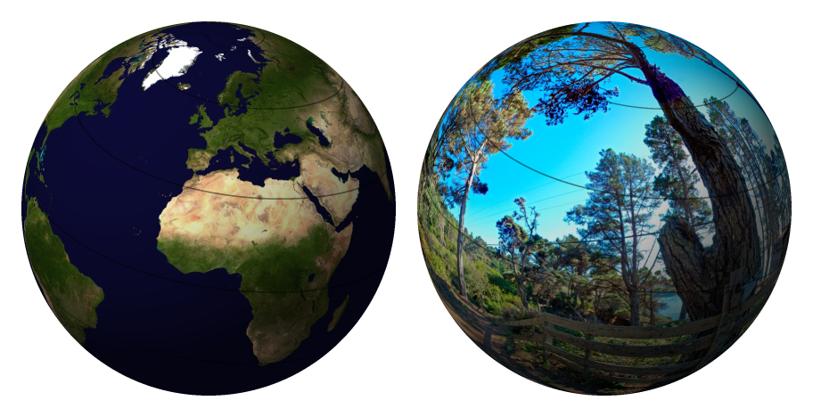
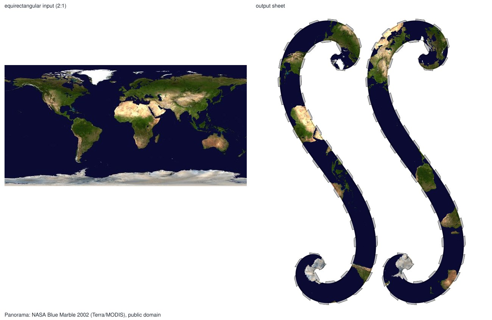
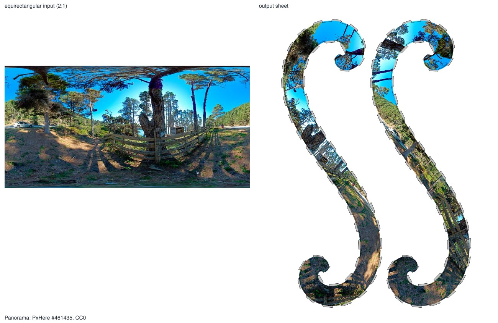
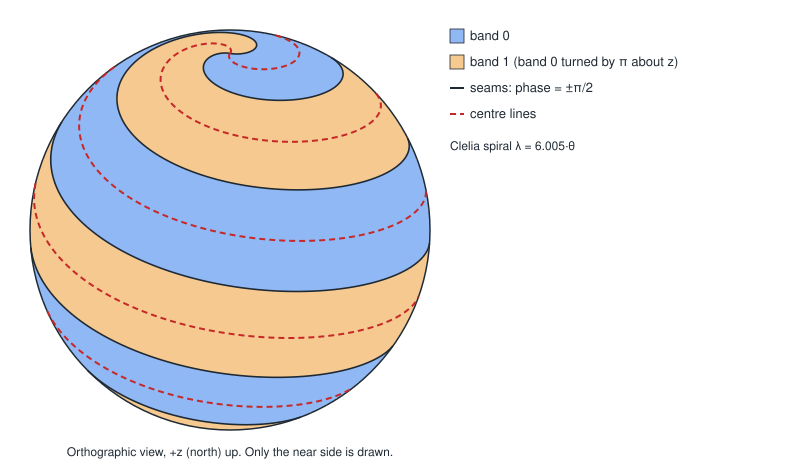
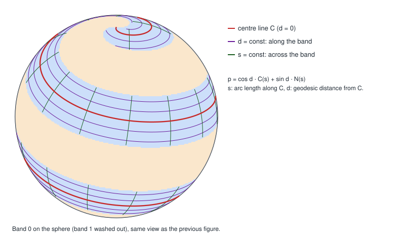
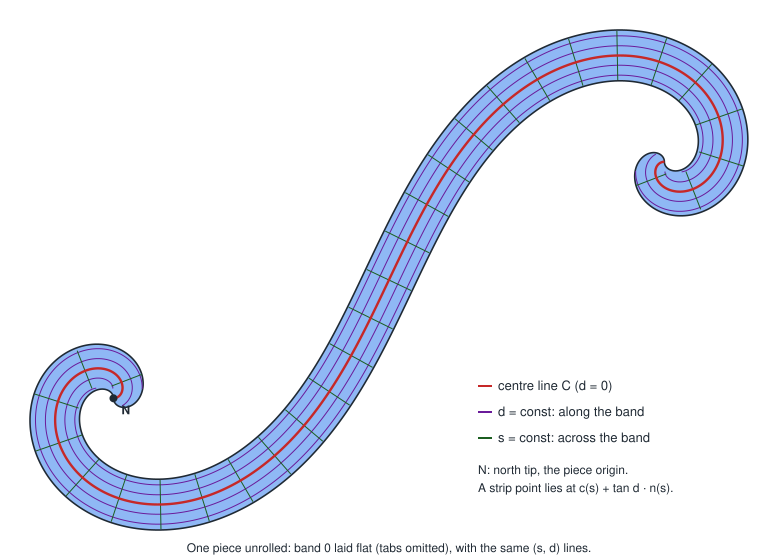
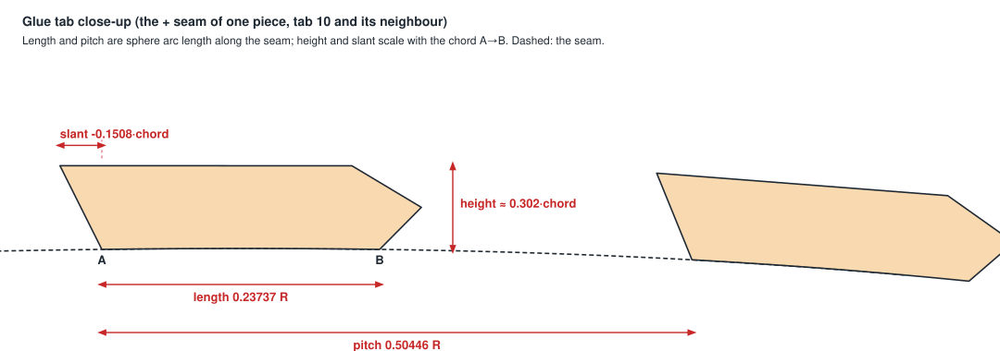

# paper-sphere

**Web app: https://sphere.schrauger.com/** (runs in your browser; the panorama stays on your machine).

Turns a 360° equirectangular panorama (2:1) into a printable two-piece paper-sphere sheet. Print the
sheet, cut out the two S-shaped pieces and join them into a sphere along their tabs. The tabs can be
glued or taped, but they don't have to be: tucked inside the seam, they hold the sphere together by
their own pressure, like the interlocking top flaps of a box. It reimplements the layout of the
defunct 360craft site (see [Credits](#credits)).



*Rendered previews of the assembled spheres made from the two example sheets below.*



*Panorama: NASA Blue Marble 2002 (Terra/MODIS), public domain; combined by Wikimedia user Meow.
[Source](https://en.wikipedia.org/wiki/File:Blue_Marble_2002.png).*



*Panorama: photo by Bob Dass on PxHere (#461435); free for personal and commercial use, attribution
required. [Source](https://pxhere.com/en/photo/461435).*

Output is a PDF (the default), PNG or JPEG sheet, optionally with the cut outline as SVG or DXF for a
cutting machine. The PDF is the default download and prints at 100% (actual size), which is what makes
the printed marks line up with the cutter.

## Web app

Use it in the browser, with no install: **https://sphere.schrauger.com/**. The panorama stays on your
machine. To run it locally, `npm run serve` and open http://localhost:8080/web/. The sheet downloads as a
PDF by default; print it at 100% (actual size, no "fit to page") so the marks line up with the cutter.

## CLI quick start

```sh
npm install
node cli.js panorama.jpg -o sheet.pdf                         # letter page, 300 dpi, prints at 100%
node cli.js panorama.jpg -o sheet.png
node cli.js panorama.jpg -o sheet.png --page a4 --bleed auto --marks silhouette
node cli.js panorama.jpg -o sheet.jpg --yaw 30 --cut-file svg # also writes sheet.svg
```

The CLI prints the sphere diameter it chose. A panorama within 1% of 2:1 is resampled to exactly 2:1;
anything else is an error.

| Option | Meaning |
|---|---|
| `-o <file>` | Output, `.pdf` (prints at 100%), `.png`, `.jpg` or `.jpeg` (required). |
| `--preset original-low\|original-high` | 360craft's own sheet sizes (2850×4160 and 5700×8320 px). Ignores `--page`, `--diameter` and `--marks`. |
| `--page letter\|a4\|a3\|tabloid\|<W>x<H>mm` | Page size (default `letter`). |
| `--dpi N` | 72–1200 (default 300). |
| `--diameter MM` | Sphere diameter (default: the largest that fits the page). |
| `--margin MM` | Margin around the sheet (default 6.35). Ignored with `--marks silhouette`, which uses 10 mm. |
| `--outline`, `--no-outline` | Draw the cut outline (default on). |
| `--bleed MM\|auto\|off` | Image printed past the cut line (default `auto`, 360craft's bleed; `off` for none). |
| `--marks silhouette` | Silhouette Studio's Type 1 registration marks at a 10 mm inset; the margin becomes 10 mm. In an SVG cut file the cut lines are red and the marks black, so you can cut by line colour and skip the marks. |
| `--yaw D`, `--pitch D`, `--roll D` | Panorama orientation in degrees (default 0, which is 360craft's layout). |
| `--cut-file svg\|dxf` | Also write the cut path as `<out>.svg` or `<out>.dxf`. SVG cut lines are smooth curves (Bézier arcs and straight lines, tab corners kept sharp), so the cutter does not jitter. |
| `--quality Q` | JPEG quality 1–100 (default 92). |

### Silhouette print & cut

Choose Letter, Silhouette marks and one of the preset sphere sizes in the web app, then download the
sheet (a PDF) and the matching `.studio3` cut file beside it. Print the PDF at 100% (no scaling or
fit to page), open the `.studio3` in Silhouette Studio, load the printed sheet and cut. The files
live in [`studio3/`](studio3/README.md) and are added size by size as they are made (none exist yet); if
one is missing for a size, the web app says so and you can use the SVG cut file instead.

`node cli.js --help` prints the same list. Node ≥ 22 is needed to run the tests (`npm test`); the
package itself runs on Node ≥ 20.

## How it works

The sheet is a two-piece "S" layout. Each piece is half of the sphere: one of two interleaved
spiral strips (bands), laid flat. The code reproduces 360craft's layout with a model that was fitted
to its outputs; [ADR-0003](docs/adr/0003-warp-model.md) has the full formula, the fit and the residuals.
The terms are in [GLOSSARY.md](GLOSSARY.md).

### 1. A centre-line spiral and two bands

A Clelia curve winds from the north pole to the south pole: its longitude is λ = rate·θ, where θ is the
polar angle from +z, and the fitted rate is 6.005. A point's *phase* is how far its longitude is from
that curve at its own θ. **Band 0** is every point with |phase| < π/2; **band 1** is band 0 turned
by π about the z axis. The two bands tile the sphere, and the seams between them are the curves
at phase ±π/2.



### 2. Coordinates on a band

Each point of a band gets coordinates (s, d) from its nearest point on the band's centre line C:
s is the arc length along C and d the geodesic distance from C, so p = cos d · C(s) + sin d · N(s)
with N = C × T. Behind each end of C, a point is nearer to the tip than to any other part of C; those
points use polar coordinates about the tip instead.



### 3. Unrolling

A band cannot be flattened without error, so the layout picks the same compromise 360craft does. C is
laid flat as a plane curve with the same geodesic curvature (it curls tightly near the tips). A point (s, d)
goes to c(s) + tan d · n(s), where n is the flat normal. This is a central projection of the band
onto the tangent developable along C: a surface that lies flat onto the plane exactly, whose rulings
run along N. Behind each tip the projection is gnomonic, with a small correction
where the tip's and the strip's coordinates overlap, so the outline has no notch.



### 4. The pixels

The sheet is rendered by inverse mapping. For every sheet pixel the renderer:
1. finds the flat point's (s, d) by inverting the map above (the foot of the perpendicular on C comes
   from a Newton iteration on p·T, started from a first-order guess);
2. goes to the sphere point, then to band 1 if the pixel is on the second piece;
3. rotates it by the orientation M = Rz(yaw)·Ry(pitch)·Rx(roll) on top of the model's fixed base
   orientation, and
4. samples the panorama there (lon = atan2(y, x), lat = asin z; wrapped in u, clamped in v).

The bleed and the cut outline use the signed distance to the band edge. The tabs are filled grey and the
rest of the sheet is white.

### 5. Tabs

The tabs are placed along each seam by arc length on the sphere, then built in the flat plane. Each
one is a pentagon whose shape scales with the seam chord it sits on.



The diagrams above are generated from the real geometry modules by `node tools/diagrams.mjs`, and the
example images by `node tools/readme-examples.mjs`.

## Accuracy

The model was checked against three real 360craft outputs and its recovered cutting outline. Summary
numbers only (the reference images are not in this repository, see
[ADR-0002](docs/adr/0002-no-personal-or-third-party-reference-data-in-git.md)):

- **Image registration** (low-resolution sheets, 18,888 matched feature points): median error
  0.31 px, 90th percentile 0.69 px. At the sheet's scale (about 492 px per sphere radius) that is
  about 0.06% of the radius.
- **Cut outline** against 360craft's DXF: mean 0.5–0.55 px, 95th percentile 1.7–1.8 px, worst case
  about 3 px, concentrated at the two curled tips. That is up to about 0.25 mm on the low-resolution
  sheet. The tabs add no error beyond the seam's.
- **Colour** at `original-high` against 360craft's renders: mean absolute error 2.4–5.1 grey levels,
  and 99.47–99.78% agreement on which pixels are image or paper. This is the fit error seen at twice the
  resolution: about one high-resolution pixel of registration.
- **Print style** (tab colour, outline width, bleed width) matches the references.

The model does not reproduce one small bulge on the convex side of each tip curl. ADR-0003 records it,
and the numbers above include it. The ready-made golden renders in `test/fixtures/` guard against
regressions of the code itself.

## Development

```sh
npm test                              # all tests; the 360craft regressions skip without local reference data
node tools/update-golden.mjs          # regenerate test/fixtures/expected/ after an intended change
node tools/diagrams.mjs               # regenerate docs/img/*.svg
npm run bench                         # performance targets
```

The fixtures in `test/fixtures/` are shareable panoramas (public domain, or free with attribution); see its
[README](test/fixtures/README.md) for sources and licenses.

## Credits

The sheet layout reproduces the behaviour of **360craft** by Takayuki Sasaki. This project is an
independent reimplementation fitted to its outputs; it contains none of its code. The example
panoramas are credited beside each image above and in `test/fixtures/README.md`.

## License

Copyright (C) 2026 schrauger. Licensed under the GNU Affero General Public License v3.0 or later; see [LICENSE](LICENSE).
